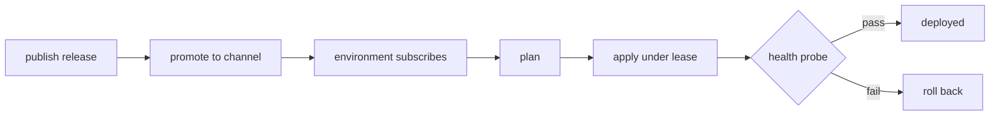

# Tenkai

**Tenkai is for governed delivery to environments you do not fully control.**

Customer-owned, disconnected, and regulated sites apply what they verify, not
what a server tells them. Every change is signed and approved. The control
plane is not trusted: a pull-only runtime checks the release and the approval
before it applies, and a failed health probe rolls the site back.

[](https://github.com/Sannrox/tenkai/actions/workflows/ci.yml)
[](https://github.com/Sannrox/tenkai/releases)
[](LICENSE)

[Quickstart](#try-it-in-five-minutes) · [Governed path](#governed-deploy-in-15-minutes) · [When not to use](#when-not-to-use-tenkai) · [Docs](docs/README.md) · [Design](DESIGN.md) · [Roadmap](docs/capabilities.md)

Tenkai (展開, "deployment") publishes immutable releases into channels. Each
environment subscribes, plans the change under its own constraints, and
applies it behind health probes.

- **Per-environment channels.** Each site follows `stable`, `beta`, or its own pin.
- **Constraints and maintenance windows.** Each environment carries its own facts and rules.
- **Signed releases and signed approvals.** Everything outside local development fails closed.
- **Automatic rollback.** A failed health probe restores the previous release.
- **Offline bundles.** Deliver to sites that never reach your network.
- **One binary to start.** Embedded mode needs no server, database, or network.

## When not to use Tenkai

Choose another path when:

- You own a single connected cluster and only need to sync a repository into it.
- You want a CI builder. Tenkai consumes signed artifacts; it does not compile them.
- Unsigned or unapproved deploys are the normal path, not a local-lab exception.
- The environment should trust the control plane instead of verifying what it applies.


## Try it in five minutes

Install `tenkaictl` into the current directory (Linux x86-64 or Apple Silicon).
The script verifies the download against the release's `SHA256SUMS`:

```bash
git clone https://github.com/Sannrox/tenkai && cd tenkai
curl -fsSL https://github.com/Sannrox/tenkai/releases/latest/download/install.sh | sh -s -- --prefix .
```

Releases before v0.7.0 ship no `install.sh`.

Deploy the example product, which writes its version to a file:

```bash
./tenkaictl init
export TENKAI_MANAGEMENT_TOKEN=tenkai-local-management   # any value works in embedded mode

./tenkaictl publish examples/hello-local/tenkai.toml --allow-unsigned-development
./tenkaictl promote hello-local@0.1.0 stable
./tenkaictl env subscribe local hello-local=stable

PLAN=$(./tenkaictl plan --env local | awk '/^plan id:/ {print $3}')
./tenkaictl apply "$PLAN" --allow-unapproved-development --development-reason quickstart
./tenkaictl status
```

```text
product                  channel    deployed     head         state
hello-local              stable     0.1.0        0.1.0        current
```

Now ship a release whose health probe fails, and watch Tenkai undo it:

```bash
./tenkaictl publish examples/hello-local/broken.toml --allow-unsigned-development
./tenkaictl promote hello-local@0.2.0 stable

PLAN=$(./tenkaictl plan --env local | awk '/^plan id:/ {print $3}')
./tenkaictl apply "$PLAN" --allow-unapproved-development --development-reason quickstart
```

`apply` reports the rollback and exits non-zero; `status` still shows 0.1.0
deployed:

```text
  upgrade   hello-local              0.1.0 -> 0.2.0
  ROLLBACK  hello-local              ... restored hello-local to 0.1.0 ...
```

The `--allow-*-development` flags work only for the built-in `local`
environment. Every other environment requires
[signed releases](docs/release-signing.md) and
[signed plan approvals](docs/plan-approval.md). Source builds, server and
runtime hosts, and manual verification are in
[GitHub Release binaries](docs/release-binaries.md).

## Governed deploy in 15 minutes

The five-minute path is unsigned and local-only. This path is what Tenkai is
for: a signed release, a required plan approval, apply under a health probe,
and automatic rollback of a bad version.

`quickstart` writes lab keys, trust roots, a manual approval policy, and a
`lab` environment. It is lab-only, not production KMS.

```bash
./tenkaictl quickstart
export TENKAI_MANAGEMENT_TOKEN=tenkai-local-management   # any value works in embedded mode

./tenkaictl dev sign-release examples/hello-local/tenkai.toml \
  --keys .tenkai-lab/keys \
  --signature .tenkai-lab/hello-local-0.1.0.sig.json \
  --trust-roots .tenkai-lab/release-trust.toml
./tenkaictl publish examples/hello-local/tenkai.toml \
  --signature .tenkai-lab/hello-local-0.1.0.sig.json \
  --trust-roots .tenkai-lab/release-trust.toml
./tenkaictl promote hello-local@0.1.0 stable
./tenkaictl env subscribe lab hello-local=stable

PLAN=$(./tenkaictl plan --env lab | awk '/^plan id:/ {print $3}')
./tenkaictl apply "$PLAN"   # fails: signed approval required

./tenkaictl dev sign-approval "$PLAN" \
  --keys .tenkai-lab/keys \
  --approval .tenkai-lab/plan.approval.json \
  --trust-roots .tenkai-lab/approval-trust.toml
./tenkaictl apply "$PLAN" \
  --approval .tenkai-lab/plan.approval.json \
  --approval-trust-roots .tenkai-lab/approval-trust.toml
./tenkaictl status --env lab
```

Then ship the broken 0.2.0 release the same way (`examples/hello-local/broken.toml`).
`apply` reports the rollback and exits non-zero; `status` still shows 0.1.0.

CI runs this journey and fails if it takes longer than 15 minutes.

## How it works



A **product** has immutable **releases**. Promoting a release moves a
**channel** to it. Each **environment** subscribes to one channel per product
and carries its own constraints, maintenance windows, and trust policy.
Plans, deployments, leases, and audit records live in Tenkai's own store, so
Tenkai stays operable and recoverable on its own
([ADR 0001](docs/decisions/0001-standalone-core-and-service-evolution.md)).

The same contract runs three ways: embedded in `tenkaictl` (as above), as the
networked `tenkai-server`, and as pull-only `tenkai-runtime` processes inside
environments the server cannot reach.

## Next steps

| I want to… | Read |
| --- | --- |
| Run Tenkai against a laptop Kubernetes cluster | [Local minikube dogfood](docs/local-dogfood-minikube.md) |
| Write a manifest for my product | [The manifest](docs/manifest.md) |
| Add environments, constraints, and maintenance windows | [Manage environments](docs/manage-environments.md) |
| Upgrade, roll back, or recover a product | [Upgrade and rollback](docs/upgrade-and-rollback.md) |
| Run the server or a remote environment runtime | [Run tenkai-server](docs/run-tenkai-server.md) |
| Install only Tenkai on a host and let it install a cluster | [Bare host to cluster](docs/bare-host.md) |
| Ship from GitHub tags | [Deploy from GitHub](docs/deploy-from-github.md) |
| Sign releases and approve plans | [Release signing](docs/release-signing.md), [plan approval](docs/plan-approval.md) |
| Deliver to disconnected sites | [Offline bundles](docs/offline-bundles.md) |
| Back up and restore state | [Backup and restore](docs/backup-restore.md) |
| Look up a setting | [Environment variables](docs/environment-variables.md) |
| Understand the design | [DESIGN.md](DESIGN.md) and [architecture decisions](docs/decisions/README.md) |

Everything else is in the [documentation index](docs/README.md).

## Status

Pre-1.0. The core delivery loop (publish, plan, apply, roll back, recover) is
in place; interfaces may still change between minor releases. See
[capabilities and roadmap](docs/capabilities.md). Work is tracked in
[GitHub Issues](https://github.com/Sannrox/tenkai/issues).

## Contributing

`make test` runs the test suite and `make validate` runs the full lint and
contract checks. Setup and pull-request flow are in
[CONTRIBUTING.md](CONTRIBUTING.md), agent workflow in [AGENTS.md](AGENTS.md),
and tagging in [RELEASING.md](RELEASING.md).

Apache-2.0 licensed.
